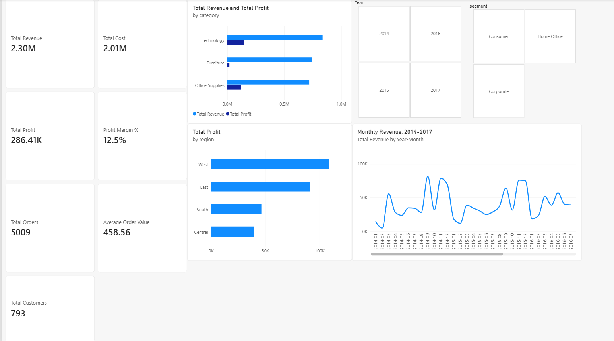
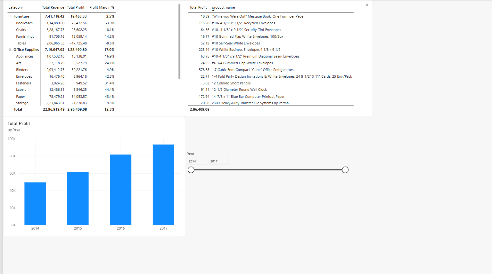
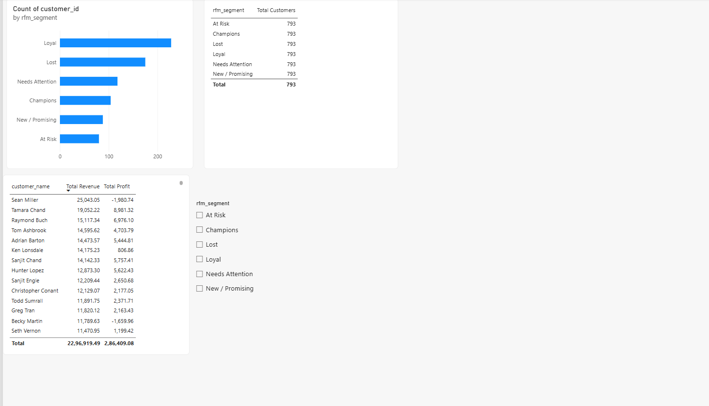
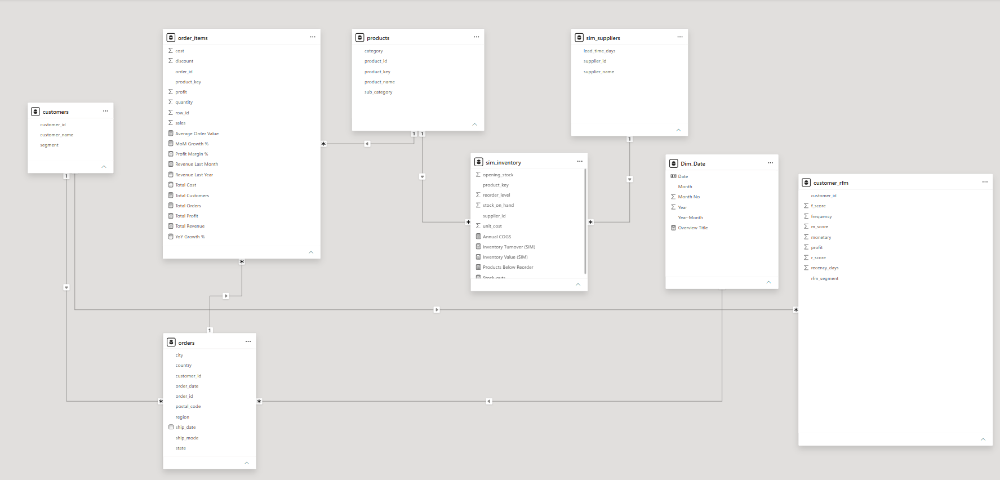

# Business Intelligence & Sales Analytics Platform

A portfolio project that turns raw retail sales data into insights using
**Python, PostgreSQL, SQL, Excel and Power BI**.

## Business problem
A retail company has thousands of transactions but cannot easily see which products,
categories, regions and customers make money. This project builds a pipeline from raw
CSV to a validated database, SQL analysis, an Excel check, and an interactive dashboard,
ending in recommendations for management.

## Objectives
- Clean and validate the raw data reproducibly
- Design a normalized PostgreSQL database
- Answer business questions in SQL (profitability, trends, customers, RFM)
- Cross-check results in Excel and Power BI
- Be transparent about derived and simulated data

## Tech stack
Python (pandas, NumPy, SQLAlchemy), PostgreSQL 16, pgAdmin, SQL, Excel, Power BI
(Power Query, DAX), Git/GitHub.

## Architecture
`````mermaid
flowchart LR
    A[Raw CSV] --> B[Python: clean and validate]
    B --> C[Cleaned CSV]
    C --> D[(PostgreSQL)]
    D --> E[SQL analysis]
    D --> F[Excel validation]
    D --> G[Power BI dashboard]
    E --> H[Management report]
`````

## Dataset
Superstore sales dataset (Kaggle, "Superstore Dataset" by Vivek Chowdhury):
9,994 order lines, 21 columns, orders from 2014-01-03 to 2017-12-30, United States.
The raw file is not stored in this repo (`data/raw/` is git-ignored). Download it from
Kaggle and save it as `data/raw/superstore.csv`.

**Not in the source data:** product cost, inventory, suppliers.
- `cost` is **derived**: `sales - profit`.
- Inventory and suppliers are **simulated** (`sim_` tables, random seed 42), built from real
  sales demand. They demonstrate the method only and are not findings about the business.

## Project structure
`````
data/        raw (ignored), cleaned, simulated
notebooks/   data inspection and EDA
scripts/     clean_data.py, db_connection.py, load_to_postgres.py,
             simulate_inventory.py, export_for_excel.py
sql/         01_schema, 02_analysis, 03_customer, 04_inventory
excel/       validation workbook
powerbi/     retail_analytics.pbix
reports/     management_report.md
docs/        screenshots
`````

## Data cleaning methodology
| Issue found | Action |
|---|---|
| Dates stored as text | Parsed with explicit `%m/%d/%Y` |
| 449 postal codes lost leading zeros (NE states) | Stored as 5-character text |
| File encoding is cp1252; curly quotes and non-breaking spaces | Read as cp1252, normalized whitespace |
| 1 near-duplicate row (Row ID 3407) | Dropped (assumed double entry) |
| 32 Product IDs with two names each | Surrogate `product_key` |
| 1,871 negative-profit rows | Kept: genuine losses |

Result: 9,993 rows, 5,009 orders, 793 customers, 1,894 products.
Control totals matched at every stage (Python, PostgreSQL, Excel, Power BI):
sales 2,296,919.49 and profit 286,409.08.

## Database design
Four normalized tables with primary keys, foreign keys and CHECK constraints:
`customers`, `products`, `orders`, `order_items`. Simulated side tables: `sim_suppliers`,
`sim_inventory`. Built from the checked fact that each order has one date, ship mode
and destination.

## SQL analysis
Queries in `sql/02_analysis`, `sql/03_customer`, `sql/04_inventory` use joins, CTEs, CASE,
window functions (RANK, NTILE, LAG), FILTER, month-over-month and year-over-year.

## Key findings
- Revenue: 484.0K (2014), 470.5K (2015), 609.2K (2016), 733.2K (2017); margin 12.5% overall.
- **Deep discounts hurt:** in every category, lines discounted over 20% lose money.
- **Furniture margin is 2.5%** vs 17.0% (Office Supplies) and 17.4% (Technology).
- **Central region margin is 7.9%**; its over-20% discount lines lose more than its total profit.
- The top customer by revenue lost money because of one heavily discounted order.
- RFM: 80 "At Risk" customers (about 195 days inactive) still hold 56.4K profit.
- New customers per year: 595, 136, 51, 11.

Full report: [reports/management_report.md](reports/management_report.md)

## Dashboard
Pages: Executive Overview, Profitability, Customers (RFM), Inventory (Simulated),
Regional & Time, Product Detail (drill-through).






## How to run
1. Install Python 3.10+, PostgreSQL 16, Power BI Desktop.
2. Clone the repo, then:
   `````
   python -m venv venv
   .\venv\Scripts\Activate.ps1
   pip install -r requirements.txt
   `````
3. Create a database named `retail_analytics` and a `.env` file:
   `````
   DB_USER=postgres
   DB_PASSWORD=your_password
   DB_HOST=localhost
   DB_PORT=5432
   DB_NAME=retail_analytics
   `````
4. Put the Kaggle CSV at `data/raw/superstore.csv`, then:
   `````
   python scripts/clean_data.py
   `````
   (The cleaned CSV is also included, so this step is optional.)
5. Run `sql/01_schema/01_create_tables.sql` in pgAdmin.
6. ```
   python scripts/load_to_postgres.py
   python scripts/simulate_inventory.py
   `````
7. Run the SQL files in `sql/` and open `powerbi/retail_analytics.pbix`
   (refresh the data source to your local server).

## Limitations and future improvements
- Cost is derived and inventory is simulated.
- Findings show association, not proven cause (product mix was not fully controlled).
- RFM rules are my own definitions; NTILE splits tied values arbitrarily.
- Future: real inventory data, cohort retention, discount-impact modelling, scheduled refresh.

## Author
Prathvini (GitHub: Prathvini30)
`````

Check that the file names in the structure list match your repo before committing. In particular, confirm `sql/03_customer/04_customer_rfm_table.sql` exists (I asked you to create it earlier and never saw it). Run `git ls-files sql` to see.

## Task 2: screenshots (no upload to me needed)

You don't need to send images to me for this. Take them yourself and save them in `docs\screenshots\`:
1. In Power BI, open each page, press **Win+Shift+S**, drag over the page, and save from the Snipping Tool.
2. Save as `executive_overview.png`, `profitability.png`, `customers_rfm.png` and `powerbi_model.png`. Clear all slicers first, so the pages show all years.
3. Optional: a pgAdmin schema screenshot, saved as `pgadmin_schema.png`.

## Task 3: commit and check

`````
git add .
git commit -m "Add README and screenshots"
git push
`````

Then open `https://github.com/Prathvini30/retail-analytics-platform` and check three things:
- The README renders, the Mermaid diagram shows, and the images load.
- **`.env` is not in the file list.**
- On the repo page, click the gear next to "About" and add a description and topics (`data-analytics`, `sql`, `postgresql`, `power-bi`, `python`, `pandas`).

## Task 4: resume and LinkedIn text

Fill in only what you can explain in an interview:

**Resume bullets**
- Built an end-to-end BI platform on a 9,993-line retail dataset: Python (pandas) cleaning with validation, a normalized PostgreSQL schema, SQL analysis, Excel validation and a 6-page Power BI dashboard.
- Reconciled sales (2.30M) and profit (286K) across Python, PostgreSQL, Excel and Power BI to the cent, and documented a cp1252 encoding bug, a duplicate row and 32 conflicting product IDs.
- Found that lines discounted over 20% lost money in every category, with Furniture margin at 2.5% vs 17% elsewhere, and quantified the discount-driven loss in Central (52.4K).
- Segmented 793 customers with RFM in SQL and identified 80 at-risk customers holding 56.4K profit for win-back targeting.
- Labelled derived cost and simulated inventory data explicitly to keep the analysis honest.

**LinkedIn project description**
"An end-to-end analytics project: raw sales CSV to a cleaned dataset (Python), a normalized PostgreSQL database, SQL business analysis (CTEs, window functions, RFM), an Excel cross-check and an interactive Power BI dashboard. Key insight: discounts above 20% lost money in every product category. Cost is derived and inventory is simulated, and both are clearly labelled. Code and report on GitHub."

## Reply with
1. The text output of `git ls-files sql`
2. Confirmation that the push worked and the README renders on GitHub (tell me if the diagram or images don't show)

Then we'll do Phase 12: your 30-second pitch, a 2-minute explanation, SQL, Python, Power BI and business questions, and a mock interview.